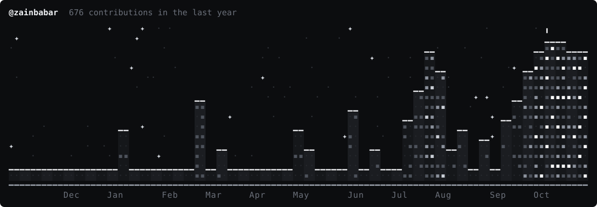

# hey, i'm zain.

second-year mathematics student at the university of waterloo.

i'm interested in ml, deep learning, and ai, from the math underneath to the systems built on top. lately that's meant implementing things from scratch and training models to see what actually happens.

[website ↗](https://zainbabar.dev)

## stack

**languages**

**ml & data**

**tools**

## selected projects

**[gpt-2 inference engine](https://github.com/zainbabar/gpt2-inference-engine)**

gpt-2 small from scratch in pytorch, verified against hugging face. kv caching for faster generation.

**[autograd engine](https://github.com/zainbabar/autograd-engine)**

reverse-mode autodiff and a neural network in c++20, verified against numerical gradients.

**[lecture rag](https://github.com/zainbabar/lecture-rag)**

dense + bm25 hybrid retrieval, a langgraph evidence check, and recall@k evaluation.

**[pathshift](https://github.com/zainbabar/pathshift)**

a cnn from scratch in pytorch, with robustness evaluation and label-free distribution shift detection.

## contributions

